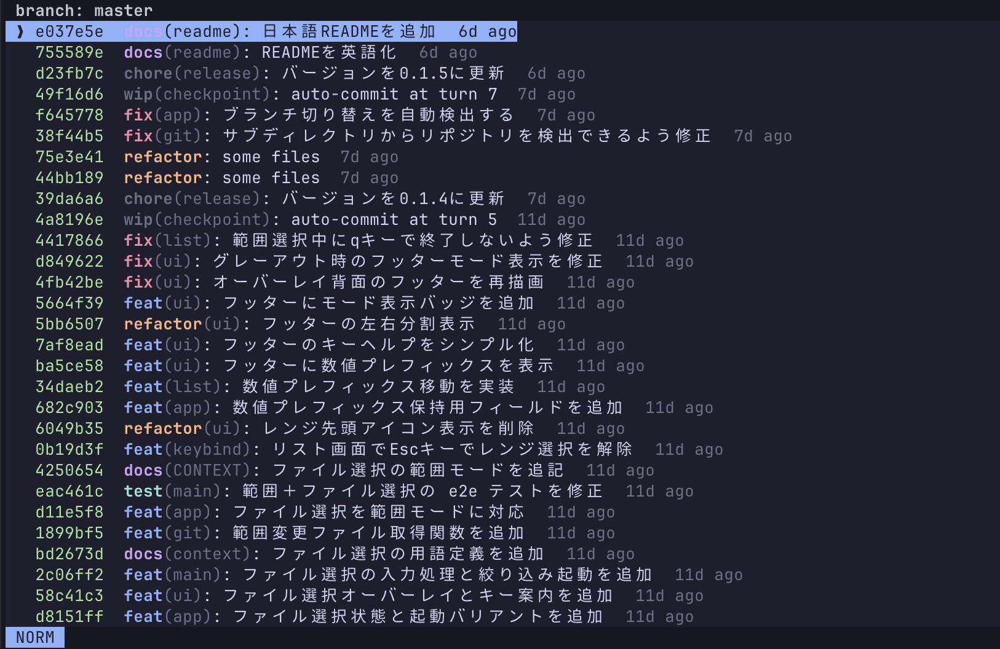

# tuit



**tuit** は、ターミナル上で動作する Git ログビューアです。Rust と [ratatui](https://github.com/ratatui/ratatui) で構築されています。

カレントディレクトリの Git リポジトリを開き、現在のブランチのコミット一覧をスクロール可能なリストで表示します。コミットを選択すると、そのコミットの本文と diff をオーバーレイで確認できます。すべての操作はキーボードだけで完結します。

## インストール

### crates.io からインストール

```bash
cargo install tuit-bin
```

### 前提条件

- [Rust](https://www.rust-lang.org/) ツールチェーン (edition 2024、Rust 1.85 以降推奨)

### ソースからビルド

```bash
git clone https://github.com/yoshikikudo/tuit.git
cd tuit
cargo build --release
```

ビルドされたバイナリは `target/release/tuit` に配置されます。お好みで `$PATH` の通ったディレクトリにコピーしてください。

## 使い方

Git リポジトリ内で `tuit` を実行するだけです。

```bash
cd /path/to/your/repo
tuit
```

サブディレクトリから起動した場合も自動的にリポジトリルートを検出します。

### キーバインド

#### コミット一覧画面

| キー | 操作 |
|------|------|
| `↑` / `k` | カーソルを上に移動 |
| `↓` / `j` | カーソルを下に移動 |
| `Enter` | 選択中のコミットの詳細を開く |
| `h` | 選択中のコミットを hunk でレビュー |
| `v` | 範囲選択の開始位置をマーク |
| `f` | 変更ファイル選択オーバーレイを開く |
| `r` | ブランチとコミット一覧を手動で再読み込み |
| `c` | 選択中のコミットのハッシュをクリップボードにコピー |
| `q` | tuit を終了 (範囲選択中は無効) |
| `?` | ヘルプオーバーレイを開く |

数値プレフィックス (例: `10j`, `5k`) での移動にも対応しています。

#### コミット詳細画面 (オーバーレイ)

| キー | 操作 |
|------|------|
| `↑` / `k` | スクロールアップ |
| `↓` / `j` | スクロールダウン |
| `Ctrl+f` / `PageDown` | 1 ページスクロールダウン |
| `Ctrl+b` / `PageUp` | 1 ページスクロールアップ |
| `Esc` | 詳細を閉じて一覧に戻る |
| `h` | 表示中のコミットを hunk でレビュー |
| `f` | 変更ファイル選択オーバーレイを開く |
| `c` | 表示中のコミットのハッシュをクリップボードにコピー |
| `?` | ヘルプオーバーレイを開く |

#### ファイル選択オーバーレイ

| キー | 操作 |
|------|------|
| `↑` / `k` | カーソルを上に移動 |
| `↓` / `j` | カーソルを下に移動 |
| `Space` | カーソル位置のファイルの選択状態を切り替え |
| `a` | すべてのファイルを選択 |
| `n` | すべてのファイルを選択解除 |
| `Enter` | 選択を確定し hunk でレビュー |
| `Esc` | キャンセルして閉じる |

### 範囲レビュー

`v` キーで範囲の開始位置をマークし、別のコミットに移動して `h` を押すと、マークから現在位置までの範囲を `hunk diff` でレビューできます。同じコミットで `v` をもう一度押すとマークが解除されます。`Esc` でも解除可能です。

### 表示内容

- **コミット一覧**: 各コミットの省略ハッシュ (7 文字)、コミットメッセージの件名、作者名、相対タイムスタンプ (`3d ago` / `2h ago` など) を一覧表示します。
- **コミット詳細**: 選択したコミットのハッシュ、作者、日付、コミット本文、および unified diff をカラーリング付きで表示します。diff の追加行・削除行・コンテキスト行はそれぞれ色分けされます。
- **ライブ同期**: アプリケーション実行中、2 秒ごとに Git リポジトリの状態をポーリングし、新しいコミット、HEAD の移動、ブランチの切り替えを自動検出します。HEAD が変わった場合はフッターに通知が表示され、コミット一覧も自動で再読み込みされます。
- **エラー表示**: Git リポジトリ外で実行した場合や、空のリポジトリ、破損した `.git` ディレクトリなどに対しては画面上にエラーメッセージを表示します。

## 設定

設定ファイルは `~/.config/tuit/config.toml` に配置します。テーマファイルは `~/.config/tuit/themes/` ディレクトリに配置します。

### 設定例 (`~/.config/tuit/config.toml`)

```toml
theme = "monokai"
poll_interval_ms = 3000
notification_timeout_ms = 5000
```

| 項目 | 説明 | デフォルト値 |
|------|------|-------------|
| `theme` | 使用するテーマ名 (`default` または `themes/` 下のファイル名) | `"default"` |
| `poll_interval_ms` | Git ポーリング間隔 (ミリ秒) | `2000` |
| `notification_timeout_ms` | フッター通知の表示時間 (ミリ秒) | `3000` |

### テーマ

デフォルトのテーマは Catppuccin Mocha を基調としたダークテーマです。`~/.config/tuit/themes/<name>.toml` にテーマファイルを作成し、`config.toml` で `theme = "<name>"` と指定することでカスタマイズできます。

利用可能なカスタマイズ項目:

- `cursor_bg`, `cursor_fg` — 選択行のハイライト色
- `list_bg` — 一覧画面の背景色
- `hash`, `message`, `author`, `date` — 各フィールドの文字色
- `detail_bg`, `detail_border` — 詳細オーバーレイの背景・枠線色
- `detail_heading`, `detail_value` — 詳細画面の見出し・値の文字色
- `diff_add`, `diff_del`, `diff_normal` — diff の追加行・削除行・コンテキスト行の色

## 技術スタック

- **言語**: Rust (edition 2024)
- **UI フレームワーク**: [ratatui](https://github.com/ratatui/ratatui) + [crossterm](https://github.com/crossterm-rs/crossterm)
- **Git データアクセス**: [gix (gitoxide)](https://github.com/Byron/gitoxide) — 純 Rust 実装、`git` CLI への依存なし
- **diff 生成**: [imara-diff](https://github.com/nickel-org/imara-diff)
- **設定管理**: TOML + [directories](https://github.com/soc/directories-rs) (XDG 準拠のパス解決)

## ライセンス

MIT License — 詳細は [LICENSE](LICENSE) を参照してください。
