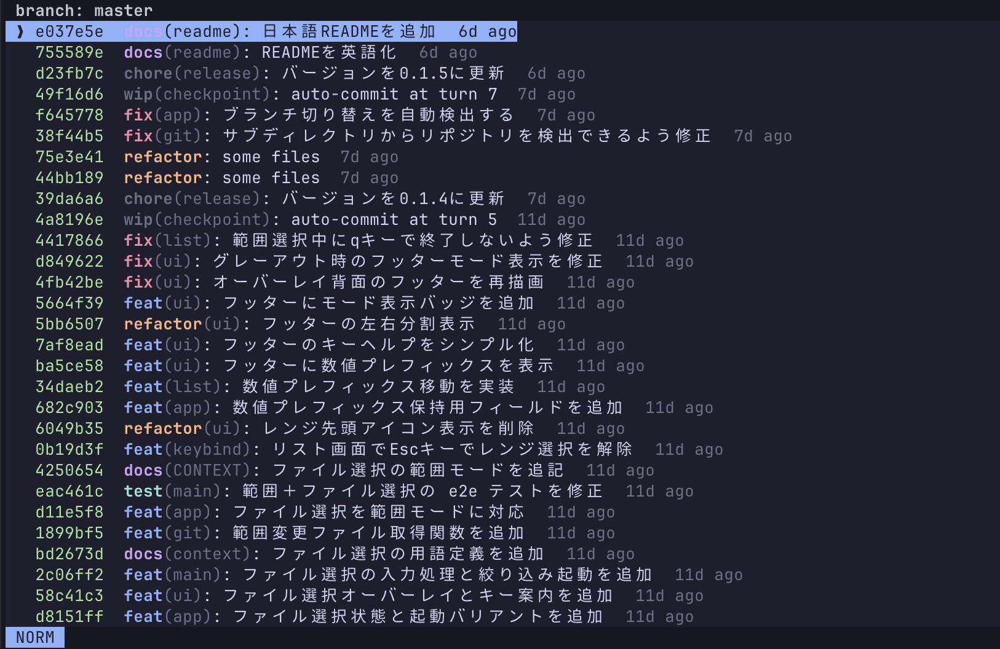

# tuit



**tuit** is a terminal-based Git log viewer built with Rust and [ratatui](https://github.com/ratatui/ratatui).

It opens the Git repository at the current directory and displays a scrollable list of commits on the current branch. Select a commit to view its full body and diff in an overlay. All operations are keyboard-driven.

## Installation

### From crates.io

```bash
cargo install tuit-bin
```

### Prerequisites

- [Rust](https://www.rust-lang.org/) toolchain (edition 2024, Rust 1.85+ recommended)

### Build from source

```bash
git clone https://github.com/yoshikikudo/tuit.git
cd tuit
cargo build --release
```

The binary will be placed at `target/release/tuit`. Copy it to a directory in your `$PATH` if desired.

## Usage

Simply run `tuit` inside a Git repository.

```bash
cd /path/to/your/repo
tuit
```

### Key bindings

#### Commit list

| Key | Action |
|-----|--------|
| `↑` / `k` | Move cursor up |
| `↓` / `j` | Move cursor down |
| `Enter` | Open detail for the selected commit |
| `w` | Open the worktree dashboard |
| `q` | Quit tuit |
| `?` | Open help overlay |

#### Commit detail (overlay)

| Key | Action |
|-----|--------|
| `↑` / `k` | Scroll up |
| `↓` / `j` | Scroll down |
| `Ctrl+f` / `PageDown` | Scroll down one page |
| `Ctrl+b` / `PageUp` | Scroll up one page |
| `Esc` | Close detail and return to list |
| `?` | Open help overlay |

#### Worktree dashboard

| Key | Action |
|-----|--------|
| `↑` / `k` | Move cursor up |
| `↓` / `j` | Move cursor down |
| `c` | Copy the selected worktree's HEAD hash to clipboard |
| `r` | Reload worktrees |
| `w` / `Esc` | Back to commit list |
| `q` | Quit tuit |
| `?` | Open help overlay |

### Display

- **Commit list**: Shows abbreviated hash (7 characters), commit subject, author name, and relative timestamp (`3d ago` / `2h ago` etc.) for each commit.
- **Commit detail**: Shows the selected commit's hash, author, date, full body, and a colorized unified diff. Added lines, deleted lines, and context lines are each color-coded.
- **Live sync**: Polls the Git repository every 2 seconds while running, automatically detecting new commits and HEAD changes. When HEAD moves, the footer turns solid blue with a centered notification. The commit list is automatically reloaded.
- **Worktree dashboard** (`w`): Shows every worktree of the repository (the main worktree plus all linked ones). The left pane draws a `git log --graph`-style topology of how each branch diverges from the base; the right pane lists one card per worktree with ahead/behind counts (relative to the main worktree's HEAD), a commit-activity sparkline over the last 14 days, and a dirty marker for uncommitted changes.
- **Error screen**: Shows an error message when run outside a Git repository, inside an empty repository, or against a broken `.git` directory.

## Configuration

Place your config file at `~/.config/tuit/config.toml`. Theme files go under `~/.config/tuit/themes/`.

### Config example (`~/.config/tuit/config.toml`)

```toml
theme = "monokai"
poll_interval_ms = 3000
notification_timeout_ms = 5000
```

| Field | Description | Default |
|-------|-------------|---------|
| `theme` | Theme name (`"default"` or a filename under `themes/`) | `"default"` |
| `poll_interval_ms` | Git polling interval (milliseconds) | `2000` |
| `notification_timeout_ms` | Footer notification display duration (milliseconds) | `3000` |

### Themes

The default theme is a dark theme based on Catppuccin Mocha. To customize, create a theme file at `~/.config/tuit/themes/<name>.toml` and set `theme = "<name>"` in your config.

Customizable fields:

- `cursor_bg`, `cursor_fg` — selected row highlight colors
- `list_bg` — list view background
- `hash`, `message`, `author`, `date` — field-specific text colors
- `detail_bg`, `detail_border` — detail overlay background and border
- `detail_heading`, `detail_value` — detail heading and value colors
- `diff_add`, `diff_del`, `diff_normal` — diff line colors (added, deleted, context)

## Tech stack

- **Language**: Rust (edition 2024)
- **UI framework**: [ratatui](https://github.com/ratatui/ratatui) + [crossterm](https://github.com/crossterm-rs/crossterm)
- **Git data access**: [gix (gitoxide)](https://github.com/Byron/gitoxide) — pure Rust, no `git` CLI dependency
- **Diff generation**: [imara-diff](https://github.com/nickel-org/imara-diff)
- **Config management**: TOML + [directories](https://github.com/soc/directories-rs) (XDG-compliant path resolution)

## License

MIT License — see [LICENSE](LICENSE) for details.
